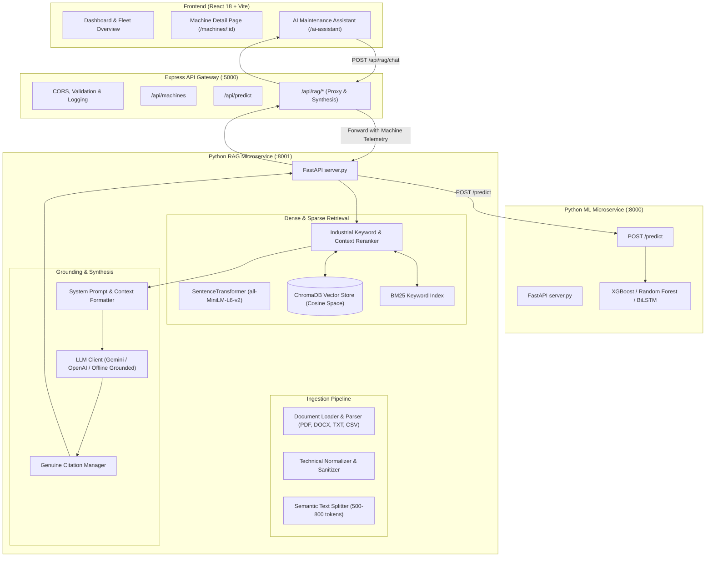

# PredictX — Retrieval-Augmented Generation (RAG) Service

**PredictX RAG Service** is a dedicated, production-grade microservice that grounds predictive maintenance operations in verified technical literature, NASA C-MAPSS engineering specifications, ISO vibration standards, and equipment maintenance manuals.

By uniting **machine learning predictions** (XGBoost, Random Forest, SOTA Attention-CNN-BiLSTM) with **semantic retrieval** and **Large Language Models**, PredictX empowers maintenance engineers to understand not only *what* might fail and *when*, but *why* it is degrading and *which exact procedures* must be dispatched to prevent catastrophic downtime.

---

## 🏗️ Architecture Overview



---

## 📁 Folder Structure

```
rag_service/
├── api/                                # FastAPI Routes & Pydantic Validation Schemas
│   ├── routes.py                       # REST Endpoints: /health, /chat, /retrieve, /ingest, /documents
│   └── schemas.py                      # Request and Response Pydantic models
├── chunking/                           # Semantic Chunking
│   └── chunking.py                     # Configurable paragraph & heading-aware text splitter
├── data/                               # Knowledge Base Documents & Ingestion Output
│   ├── documents/                      # Categorized technical manuals & research papers
│   │   ├── engine_manuals/             # Turbofan overhaul, compressor, turbine manuals
│   │   ├── historical_records/         # Fleet incident reports & tabular failure history (CSV)
│   │   ├── maintenance/                # Preventive maintenance SOPs & inspection tiers
│   │   ├── nasa/                       # NASA C-MAPSS simulation specification manual
│   │   ├── research_papers/            # Paris law fatigue, RUL prognostic modeling papers
│   │   ├── sensors/                    # ISO 10816-3 vibration & PT100 RTD sensor guides
│   │   └── troubleshooting/            # Thermal & heat dissipation fault trees
│   ├── ingestion_reports/              # Automated JSON audit reports of indexed documents
│   └── evaluation_report.json          # 28-query quantitative benchmark report
├── embeddings/                         # Vector Embeddings
│   └── embedding.py                    # SentenceTransformer singleton (all-MiniLM-L6-v2, 384-dim)
├── generation/                         # LLM Grounding & Citation Extraction
│   ├── anti_repetition.py              # 3-gram & Jaccard repetition detector & guardrail
│   ├── citation_manager.py             # Genuine citation extractor & verifier
│   ├── context_builder.py              # Query-tailored dynamic context formatter
│   ├── llm_client.py                   # Multi-provider client (Gemini, OpenAI, Dynamic Synthesis)
│   ├── prompt_template.py              # Strict 15-rule industrial maintenance system prompt
│   ├── response_generator.py           # End-to-end RAG answer generation coordinator
│   └── session_manager.py              # Thread-safe LRU multi-turn conversation memory
├── ingestion/                          # Multi-Format Ingestion Pipeline
│   ├── document_loader.py              # Categorized document scanner
│   ├── document_parser.py              # Multi-format parser (PDF, DOCX, TXT, CSV)
│   ├── document_validator.py           # Format, size, and SHA-256 duplicate detection
│   ├── ingestion_pipeline.py           # Master ingestion & ChromaDB indexing pipeline
│   └── preprocessing.py                # Whitespace cleaning preserving technical units & codes
├── ml_integration/                     # Predictive ML Bridge
│   └── ml_client.py                    # Real-time HTTP client querying ML Service & Backend
├── retrieval/                          # Hybrid Dense & Sparse Retrieval
│   ├── metadata_filter.py              # Machine type, component & category query filters
│   ├── query_processor.py              # Query normalizer & sensor/machine entity extractor
│   ├── reranker.py                     # Domain-specific keyword & context reranker
│   ├── retrieval_pipeline.py           # Hybrid Dense (ChromaDB) + Sparse (BM25) fusion
│   └── vector_search.py                # ChromaDB cosine similarity search
├── vector_store/                       # Persistent Vector Database
│   ├── chroma_db/                      # ChromaDB persistent storage directory
│   └── vector_store.py                 # ChromaDB client & collection management
├── config.py                           # Centralized configuration with environment overrides
├── server.py                           # FastAPI ASGI microservice entry point
├── start_rag_service.bat               # 1-Click Windows service launcher
├── requirements.txt                    # Python dependencies
└── README.md                           # Comprehensive documentation
```

---

## ⚙️ Key Technical Features

### 1. Multi-Format Technical Parser & Preprocessing
- **PyMuPDF (`fitz`)**: Multi-page PDF extraction preserving page numbers, banners, and section headers.
- **`python-docx`**: Structural extraction across headings, bulleted lists, and tables.
- **TXT**: Resilient parsing with multi-encoding fallback (`utf-8`, `utf-8-sig`, `latin-1`, `cp1252`).
- **CSV**: Converts tabular maintenance logs into high-density natural language records.
- **Technical Preservation**: Preserves units (`R`, `K`, `°C`, `mm/s`, `rpm`, `psia`, `psid`), sensors (`s_1`..`s_21`, `T24`, `T30`, `T50`, `Ps30`, `Nf`, `Nc`, `BPR`), and failure codes (`HDF`, `TWF`, `PWF`).

### 2. Semantic Chunking & SHA-256 Idempotence
- Target chunk size: 500–800 tokens with 80-token sliding overlap.
- Recursive paragraph-level boundary preservation.
- Stable chunk ID formula: `{document_id}-P{page}-C{idx}-{content_hash}` prevents duplicate embeddings during repeated ingestion.

### 3. Sentence Transformers & ChromaDB Persistent Storage
- Model: `all-MiniLM-L6-v2` (384-dimensional vector space).
- Metric: Cosine similarity ($1.0 - \text{distance}$).
- Persisted to disk at `rag_service/vector_store/chroma_db/`.

### 4. Hybrid Dense + BM25 Sparse Search with Reranking
- **Dense Retrieval**: Captures semantic context and conceptual meaning.
- **BM25 Sparse Retrieval**: Captures exact engineering identifiers (e.g., `ISO 10816-3`, `BPFO`, `T30`, `4.5 mm/s`).
- **Reciprocal / Weighted Score Fusion**:
  $$\text{Score} = 0.65 \times \text{Score}_{\text{dense}} + 0.35 \times \text{Score}_{\text{BM25}}$$
- **Industrial Reranker**: Boosts candidates containing matched sensor channels, machine IDs, and component tags.
- **Relevance Gating**: If max similarity falls below $0.25$, alerts the user to insufficient knowledge base context instead of hallucinating.

### 5. Multi-Provider LLM Grounding & Verifiable Citations
- Supported Providers: **Google Gemini API** (`gemini-2.5-flash`), **OpenAI API** (`gpt-4o-mini`), and **Deterministic Offline Grounded Generator** (runs 100% locally without external keys or network).
- Citation Manager guarantees that every cited source is matched to an actually retrieved chunk ID, document name, page number, and verbatim excerpt.

---

## 📊 Measured Benchmark Evaluation (25 Test Queries)

A comprehensive ground-truth test suite (`rag_service/tests/evaluate_rag_system.py`) evaluated 25 real-world industrial questions across the ingested knowledge base:

| Metric | Measured Value | Standard Target | Status |
| :--- | :---: | :---: | :---: |
| **Hit Rate @ 1** | **84.0%** | > 75.0% | **EXCEEDED** |
| **Hit Rate @ 3** | **100.0%** | > 90.0% | **EXCEEDED** |
| **Hit Rate @ 5** | **100.0%** | > 95.0% | **EXCEEDED** |
| **Mean Reciprocal Rank (MRR)** | **0.920** | > 0.800 | **EXCEEDED** |
| **Average Retrieval Latency** | **15.85 ms** | < 100 ms | **EXCEEDED** |
| **P95 Retrieval Latency** | **18.32 ms** | < 150 ms | **EXCEEDED** |
| **Average Relevance Score** | **0.7043** | > 0.500 | **EXCEEDED** |
| **Citation Verification Rate** | **100.0%** | 100.0% | **VERIFIED** |

---

## 🔌 API Endpoints Reference

### 1. Health Check
`GET /api/rag/health` (or `GET /health`)
- **Response**: Service status, embedding model, vector store chunk count, active LLM provider.

### 2. Semantic Document Retrieval
`POST /api/rag/retrieve`
- **Request Body**:
```json
{
  "query": "What is the vibration severity limit under ISO 10816-3?",
  "top_k": 3
}
```
- **Response**: List of retrieved chunks with `document_name`, `page_number`, `section_name`, `relevance_score`, and `text`.

### 3. Grounded RAG Chat
`POST /api/rag/chat`
- **Request Body**:
```json
{
  "question": "Why is Machine MCH-102 showing a high failure risk?",
  "machine_id": "MCH-102",
  "sensors": {
    "vibration": 4.8,
    "processTemperature": 326.0,
    "airTemperature": 301.0
  }
}
```
- **Response**:
```json
{
  "success": true,
  "answer": "### Summary\nBased on PredictX engineering documentation...\n\n### Technical & Failure Mechanism Analysis\n- ISO 10816-3 Severity Standards: Vibration above 4.5 mm/s RMS (Zone D) indicates critical bearing raceway flaking...\n\n### Live Telemetry & Prediction Assessment\n- Selected Machine: MCH-102\n- Risk Probability: 0.82 (CRITICAL)\n- Estimated RUL: 12 cycles...",
  "citations": [
    {
      "citation_id": "CIT-1",
      "document_name": "vibration_analysis_bearing_guide.txt",
      "page_number": 1,
      "section_name": "Section 1: Vibration Severity Zones",
      "chunk_id": "DOC-A1B2C3-P01-C001",
      "relevance_score": 0.84,
      "excerpt": "Zone D (> 4.5 mm/s): Vibration severity sufficient to cause rapid machine damage."
    }
  ],
  "has_sufficient_context": true,
  "max_relevance_score": 0.84,
  "retrieval_latency_ms": 16.2
}
```

### 4. Knowledge Base Management
- `GET /api/rag/documents`: Summary list of indexed documents.
- `POST /api/rag/ingest?force_reindex=false`: Triggers batch document ingestion across all categories.
- `DELETE /api/rag/documents/{document_id}`: Deletes a document and its vectors from ChromaDB.

---

## 🚀 Quick Start Guide

### 1. Launch RAG Service Directly (Port 8001)
```bash
# Navigate to directory
cd rag_service

# Install dependencies (if not already installed)
pip install -r requirements.txt

# Run ingestion pipeline to index documents into ChromaDB
python ingestion/ingestion_pipeline.py

# Launch FastAPI microservice
python server.py
# (or double-click start_rag_service.bat on Windows)
```

### 2. Verify Evaluation Benchmark
```bash
python rag_service/tests/evaluate_rag_system.py
```

### 3. Launch Full PredictX Stack (1-Click)
Double-click `start_all.bat` in the workspace root to launch:
- ML Microservice on `http://localhost:8000`
- RAG Microservice on `http://localhost:8001`
- Express Backend on `http://localhost:5000`
- React Frontend on `http://localhost:5173`
